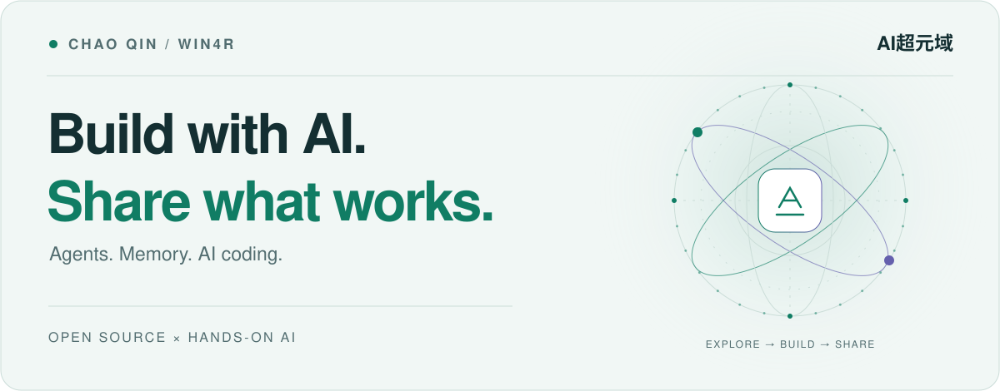
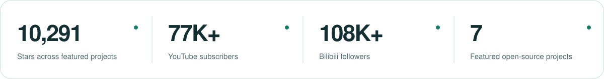
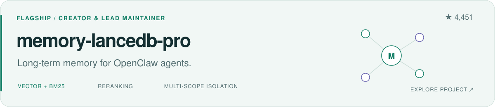

<!-- Generated by scripts/render_profile.py. Edit the source, then render. -->
<picture>
  <source media="(prefers-color-scheme: dark)" srcset="./assets/hero-dark.svg">
  <source media="(prefers-color-scheme: light)" srcset="./assets/hero-light.svg">
  
</picture>

  <b>AI builder, open-source maintainer & creator of AI超元域.</b> 
  I build agent tools, test AI in real projects, and share the process. 
  AI 技术 · 开源项目 · 实践笔记

  
  
  
  

<picture>
  <source media="(prefers-color-scheme: dark)" srcset="./assets/metrics-dark.svg">
  <source media="(prefers-color-scheme: light)" srcset="./assets/metrics-light.svg">
  
</picture>

  <a href="#selected-open-source">Projects</a> &nbsp; / &nbsp;
  <a href="#watch--build">Watch & build</a> &nbsp; / &nbsp;
  <a href="#currently-exploring">Exploring</a> &nbsp; / &nbsp;
  <a href="https://www.aivi.fyi/">Writing ↗</a>

## Selected open source

<a href="https://github.com/CortexReach/memory-lancedb-pro">
<picture>
  <source media="(prefers-color-scheme: dark)" srcset="./assets/flagship-dark.svg">
  <source media="(prefers-color-scheme: light)" srcset="./assets/flagship-light.svg">
  
</picture>
</a>

**Give agents memory that carries across sessions.** I created and lead-maintain [memory-lancedb-pro](https://github.com/CortexReach/memory-lancedb-pro): hybrid vector + BM25 retrieval, cross-encoder reranking, and memory isolation across agents, users and projects. [Watch the walkthrough ↗](https://youtu.be/bhuGrjuCM_g)

<table>
<tr>
<td width="50%" valign="top">
MULTI-MODEL WORKSPACE
<h3><a href="https://github.com/win4r/AISuperDomain">AISuper&#8203;Domain</a></h3>

Ask once. Compare answers from multiple AI models in one desktop workspace.

</td>
<td width="50%" valign="top">
MULTI-AGENT COORDINATION
<h3><a href="https://github.com/win4r/ClawTeam-OpenClaw">ClawTeam-&#8203;OpenClaw</a></h3>

Bring CLI coding agents together with OpenClaw as the default agent.

OpenClaw adaptation of <a href="https://github.com/HKUDS/ClawTeam">HKUDS/ClawTeam</a>.

</td>
</tr>
<tr>
<td width="50%" valign="top">
CLAUDE CODE FIELD NOTES
<h3><a href="https://github.com/win4r/cc-notebook">cc-&#8203;notebook</a></h3>

Explore notes on context, memory, model switching and multi-agent architecture.

</td>
<td width="50%" valign="top">
KNOWLEDGE & RETRIEVAL
<h3><a href="https://github.com/win4r/GraphRAG4OpenWebUI">GraphRAG4&#8203;OpenWebUI</a></h3>

Connect Microsoft GraphRAG to Open WebUI with local, global and web search.

</td>
</tr>
<tr>
<td width="50%" valign="top">
AGENT INTEROPERABILITY
<h3><a href="https://github.com/win4r/openclaw-a2a-gateway">openclaw-&#8203;a2a-&#8203;gateway</a></h3>

Let OpenClaw agents discover and communicate with each other across servers.

</td>
<td width="50%" valign="top">
REUSABLE AGENT SKILL
<h3><a href="https://github.com/win4r/OpenClaw-Skill">OpenClaw-&#8203;Skill</a></h3>

Install, configure, operate and troubleshoot OpenClaw with an AI coding assistant.

</td>
</tr>
</table>

**Contributing upstream:** CJK token estimation and CJK trigram search from [lossless-claw-enhanced](https://github.com/win4r/lossless-claw-enhanced) were merged into [lossless-claw](https://github.com/Martian-Engineering/lossless-claw). The original fork is retired; use upstream for new installs.

## Watch & build

Hands-on AI tests, agent workflows and tutorials — with the projects and implementation details to explore for yourself.

<table>
<tr>
<td width="50%" valign="top">

<b><a href="https://youtu.be/bhuGrjuCM_g">Give your agent long-term memory ↗</a></b>

From installation to hybrid retrieval.
</td>
<td width="50%" valign="top">

<b><a href="https://youtu.be/aZT9d8qrirY">Build with a team of agents ↗</a></b>

Explore ClawTeam and OpenClaw in practice.
</td>
</tr>
</table>

**More from the lab:** [Unlimited-OCR-2 deployment & document tests](https://youtu.be/W7lSIikNJBI) · [YouTube videos](https://www.youtube.com/@AIsuperdomain/videos) · [Bilibili videos](https://space.bilibili.com/3493277319825652) · [Technical articles](https://www.aivi.fyi/)

## Currently exploring

- **Agent systems** — long-term memory, multi-agent coordination and interoperability.
- **AI coding** — Claude Code, Codex, context engineering and reusable workflows.
- **Applied AI** — RAG, model fine-tuning, multimodal tools and local deployment.

 

  <b>Build something useful. Share what you learn.</b> 
  Find me on <a href="https://www.youtube.com/@AIsuperdomain">YouTube</a>, <a href="https://space.bilibili.com/3493277319825652">Bilibili</a>, <a href="https://x.com/AISuperDomain">X</a> or <a href="https://www.aivi.fyi/">the blog</a> · Away from the keyboard: archery.

<!-- GitHub stars refreshed 2026-10-31. YouTube 77K+ is a manually verified lower bound as of 2026-10-30; it is not a live subscriber counter. Stars sum only the 7 featured repositories, including the attributed ClawTeam adaptation. -->
